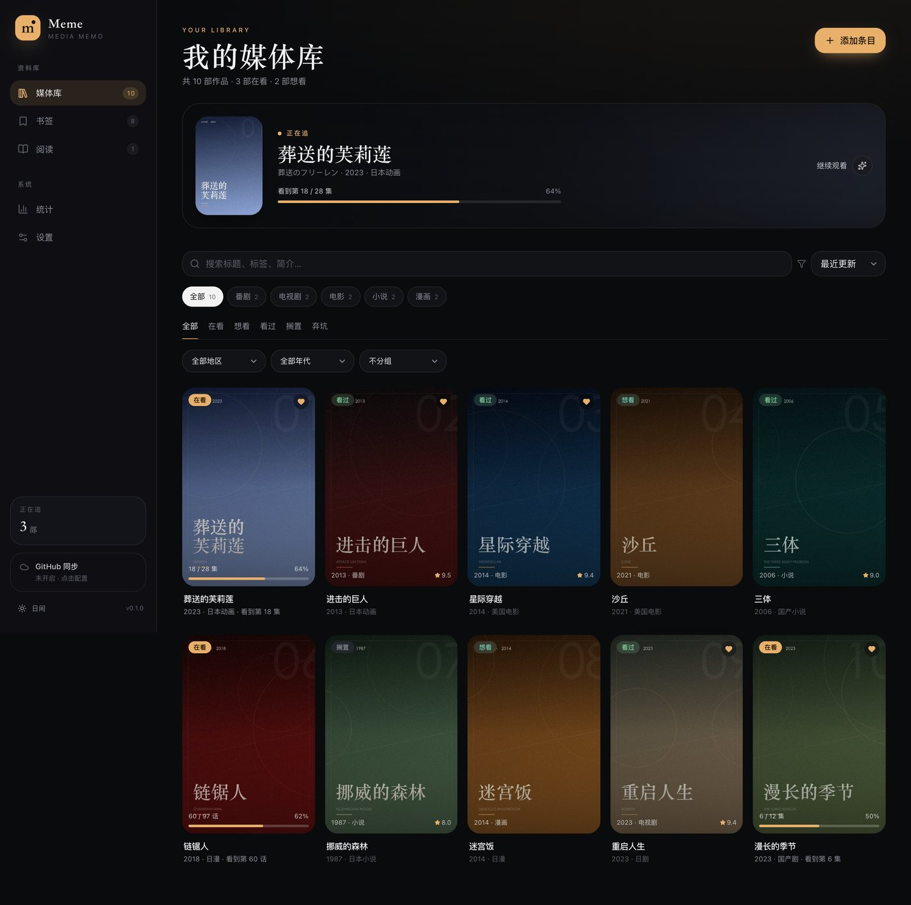
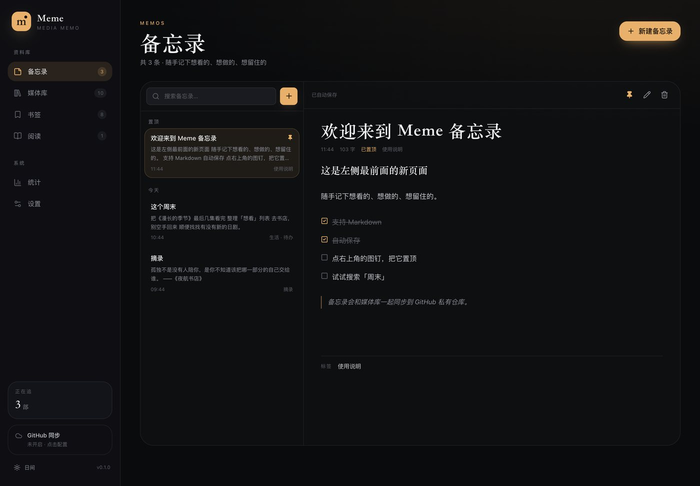
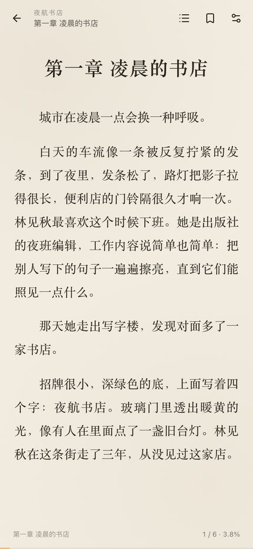
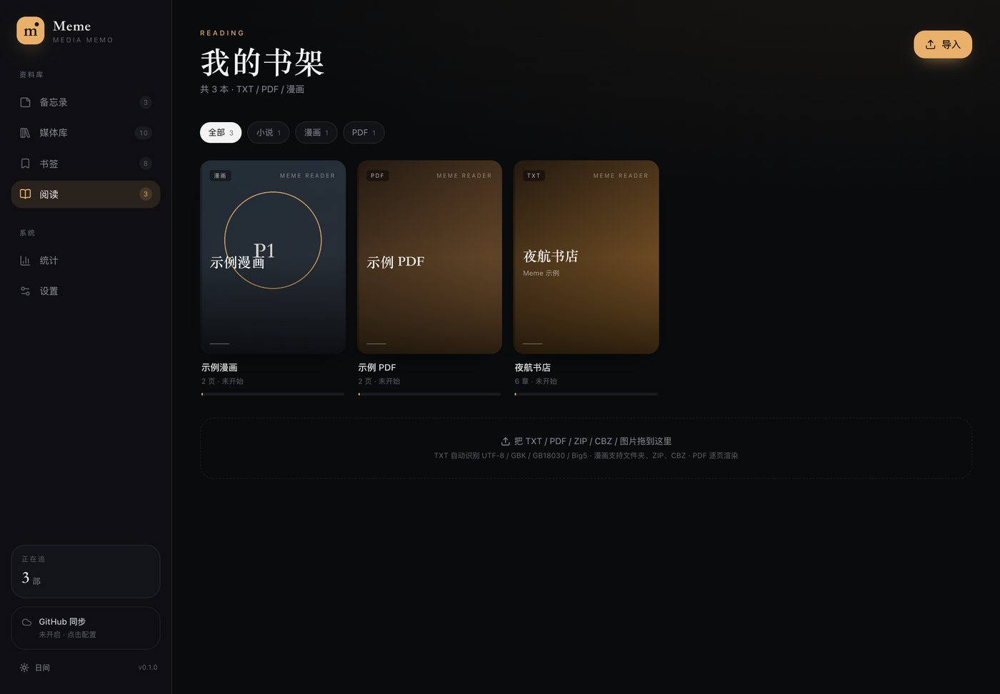
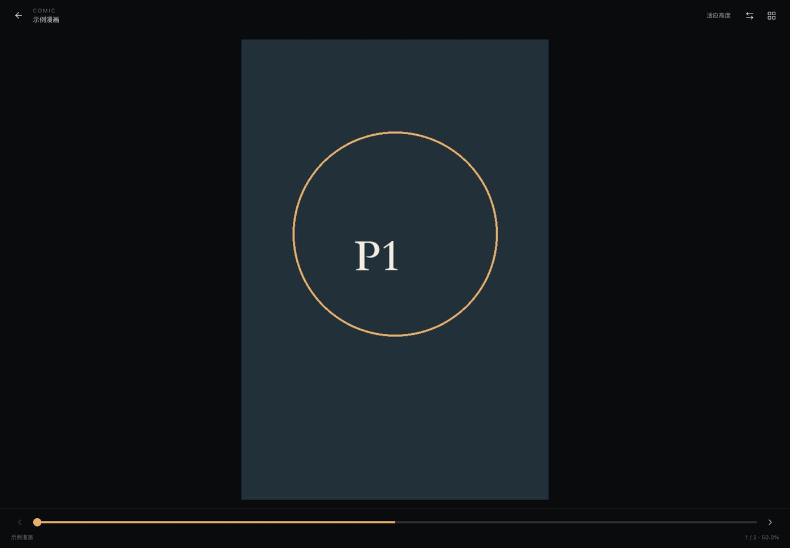
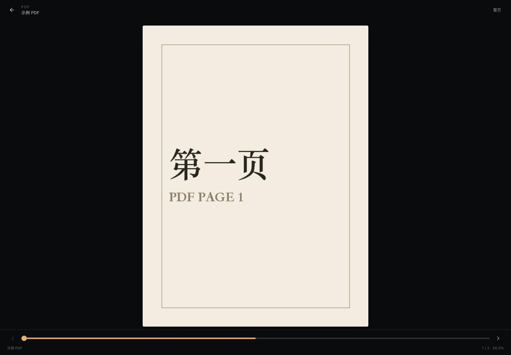
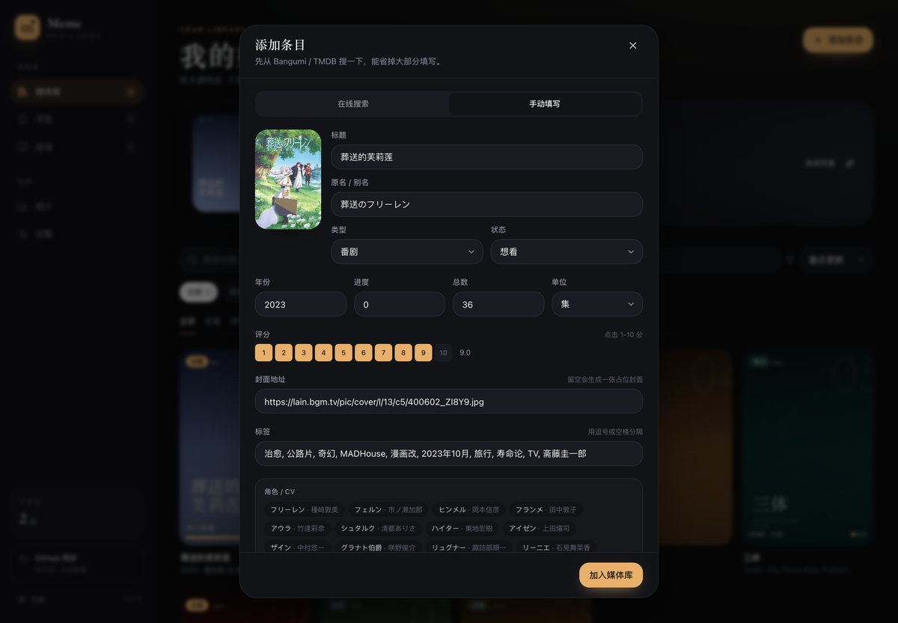
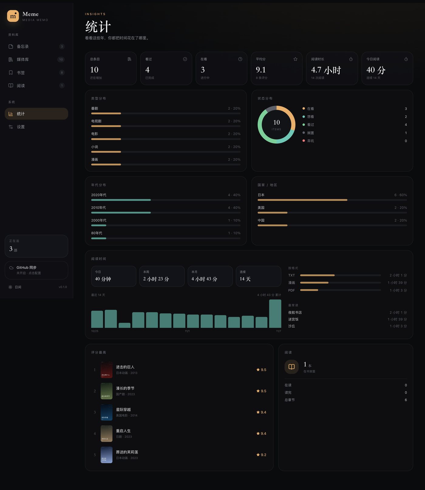
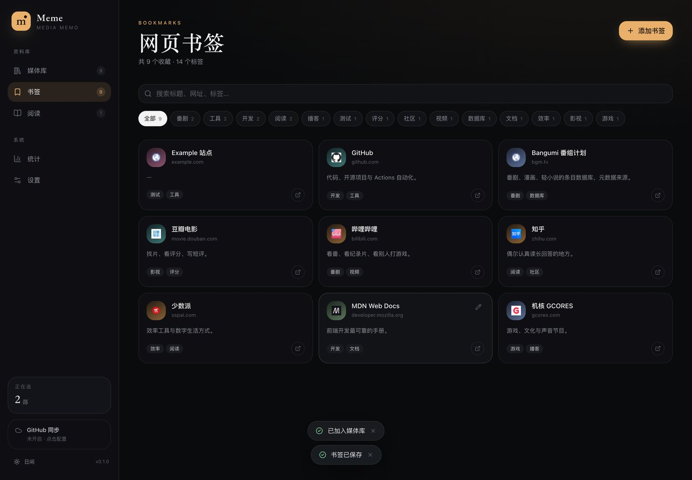

# Meme

[](https://github.com/zxy-fish/Meme/actions/workflows/ci.yml)
[](https://github.com/zxy-fish/Meme/actions/workflows/pages.yml)
[](https://github.com/zxy-fish/Meme/actions/workflows/desktop.yml)

> 把看过的、在看的、想看的番剧 / 电视剧 / 电影 / 小说 / 漫画和网页，收进一个地方。
> 本地优先，元数据一键补全，手机和电脑同步；内置备忘录和 Kindle 手感的阅读器。

Meme 是一个个人媒体库（Media Memo）：记录 + 整理 + 阅读。它不做在线播放，也不替你找片源；它只负责把你已经看过和想看的那些东西，安静地收好。



## 现在能做什么

- **六类条目**：番剧、电视剧、电影、小说、漫画，以及独立的网页书签。
- **状态与进度**：想看 / 在看 / 看过 / 搁置 / 弃坑；集数、话数、卷数、百分比进度；评分、收藏、标签、短评、笔记。
- **分类**：按年代（2020年代 / 2010年代 / 90年代…）、国家/地区（日剧、美剧、国产剧、日漫…）、类型筛选和分组；统计页同样按这三类展开。
- **元数据一键填充**：搜标题 → 选条目 → 自动带出封面、原名、年份、话数、制作公司、角色、CV、简介、Bangumi / TMDB 链接。
  - 番剧 / 漫画 / 小说：Bangumi（主力），AniList（兜底）。
  - 电影 / 电视剧：优先 TMDB（填免费 API Key，数据更全）；没有 Key 时自动走 Bangumi。
- **备忘录**：列表 + 编辑器，置顶、搜索、标签、Markdown（预览 / 编辑切换）、自动保存；和媒体库一起同步。
- **网页书签**：网址、描述、标签；点击标签筛选。适合收番剧站、资料站、工具站。
- **阅读器**：TXT / PDF / 漫画（图片文件夹、ZIP、CBZ）。TXT 自动识别编码、章节、分页；PDF 逐页渲染；漫画支持右到左 / 左到右、页码、适应高度 / 宽度；三者都自动保存进度。
- **阅读联动**：导入文件时可以关联到媒体库里的书 / 漫画条目，阅读进度会写回条目的进度和状态；媒体详情新增「阅读」标签，可以直接继续读。
- **统计**：类型、状态、年代、国家分布；阅读时长（今日 / 本周 / 本月 / 连续天数、最近 14 天曲线、按 TXT / PDF / 漫画拆分、最常读）。
- **多端同步**：数据存本地 IndexedDB，联网时和你的 **GitHub 私有仓库** 合并。每次同步是一次 commit，历史本身就是备份。
- **PWA**：可以添加到 Android / iOS 主屏幕，也可以直接当桌面网页用。

## 截图

| 备忘录 | 阅读器（手机） |
| --- | --- |
|  |  |

| 书架（TXT / PDF / 漫画） | 漫画阅读器 |
| --- | --- |
|  |  |

| PDF 阅读器 | 一键填充 |
| --- | --- |
|  |  |

| 统计 |
| --- |
|  |

| 网页书签 |
| --- |
|  |

## 在线使用

Web 版已经通过 GitHub Pages 部署：

**<https://zxy-fish.github.io/Meme/>**

Android Chrome 打开后可以「添加到主屏幕」，当成 App 用。数据存在本机，同步需要按下一节配置 Token。

## 分类与标签

Meme 不把「年份、国家、类型」硬塞进自由标签，而是做成结构化字段，筛选、分组、统计都能直接使用：

- **时间**：按作品年代（2020年代 / 2010年代 / 2000年代 / 90年代 / 80年代 / 更早）筛选和分组；统计页有年代分布。
- **国家 / 地区**：日本、中国、美国、韩国、英国、台湾、香港、泰国等；电视剧会自动显示为 **日剧 / 美剧 / 国产剧 / 韩剧 / 英剧**，其他类型显示日本动画、美国电影、日漫等。
- **类型**：番剧、电视剧、电影、小说、漫画。
- **自动补全**：Bangumi / TMDB / AniList 返回的年份、国家、题材标签会自动带进表单；示例条目会补全国家，旧数据里的「地区未标」可以在编辑里补。
- 自由的题材标签（治愈、悬疑、公路片…）仍保留，和上面的分类维度互不冲突。

媒体库支持按年代 / 国家 / 类型分组查看，统计页按这三类展开。

## 快速开始

要求 Node.js 22+ 和 pnpm。

```bash
pnpm install
pnpm dev          # http://127.0.0.1:5173
pnpm build        # 产出 dist/
pnpm preview
pnpm test         # 单元测试（合并、章节、编码）
pnpm e2e          # Playwright（本机默认使用 Edge）

# 桌面端（macOS / Windows）
pnpm build
pnpm exec electron-builder --mac   # 或 --win
```

首次打开会生成一组示例数据（10 个条目、8 个书签、一本示例小说、3 条示例备忘录）。示例封面是脚本生成的占位海报，真实搜索会使用 Bangumi / TMDB 的封面。

## 配置 GitHub 同步

数据仓库和代码仓库是分开的：代码可以公开，**数据仓库请保持私有**。

1. 新建一个私有仓库，例如 `你的用户名/meme-data`（默认为 `zxy-fish/meme-data`）。
2. 创建一个 GitHub Token：
   - 经典 Token：勾选 `repo` 权限即可；
   - 或者 fine-grained Token：只授权 `meme-data` 仓库的 **Contents: Read and write**。
   - 直达链接：<https://github.com/settings/tokens/new?scopes=repo&description=Meme%20Sync>
3. 打开 App → 设置 → GitHub 同步：
   - Owner / 数据仓库 / 分支 / 文件路径（默认 `data/library.json`）；
   - 粘贴 Token；
   - 点「测试连接」，再点「立即同步」。
4. 打开「自动同步」。之后打开 App、切回前台、每 5 分钟都会自动检查一次。

同步规则：按每条记录的 `updatedAt` 做 Last-Write-Wins 合并；删除用墓碑字段，避免旧设备把已删除的条目复活。Token 只存在本机浏览器 localStorage；换设备时需要重新填一次。

> 数据里不包含 TXT / PDF / 漫画正文，只包含书籍元数据、备忘录和阅读进度，避免仓库膨胀。
>
> 书籍 ID 按内容哈希生成：在手机和电脑分别导入同一个 TXT / PDF / ZIP 文件，会合并成同一条记录，阅读进度可以互通。

## 桌面端

Electron 壳加载的是同一份 `dist/`，数据仍然存在本机（`app://meme` 自定义协议，IndexedDB 可用）。

- 本地构建：`pnpm build && pnpm exec electron-builder --mac`（或 `--win`），产物在 `release/`。
- 云端出包：GitHub Actions 的 **Desktop builds** 工作流，手动触发或打 `v*` tag，下载 Artifacts。
- 安装包没有做代码签名：macOS 首次打开需要右键 → 打开；Windows 可能提示 SmartScreen。个人使用足够，公开分发需要自己补签名证书。

## 元数据

| 来源 | 覆盖 | 说明 |
| --- | --- | --- |
| [Bangumi](https://bgm.tv) | 番剧、漫画、轻小说 | 中文标题、CV、制作人员、章节；无需 Key |
| [AniList](https://anilist.co) | 番剧、漫画 | Bangumi 不可用时的兜底；日文 / 英文标题 |
| [TMDB](https://www.themoviedb.org) | 电影、电视剧 | 需要免费 API Key；中文简介、季集、演员；没有 Key 时由 Bangumi 兜底 |

搜索和详情请求都在浏览器 / Electron 里直接发出，不经过任何中间服务器。如果所在网络访问不稳定，可以在设置里配置代理（规划中）。

## 阅读器

- **TXT**：编码探测、BOM、CRLF 归一化；按「第 X 章 / 卷 / 回 / 序章 / 番外 / Chapter N」切章；识别失败时按 6000 字切块；CSS 多栏分页，宋体 / 黑体 / 楷体，纸黄 / 夜间 / 护眼 / 纯白。
- **PDF**：逐页渲染，整页 / 适宽，页码滑杆；文件存在本机 IndexedDB。
- **漫画**：图片文件夹、ZIP、CBZ；按文件名自然排序；默认日漫「右 → 左」，可切换方向；页码网格、单页 / 适宽、滑杆翻页。
- **关联媒体库**：导入时自动匹配同名条目，也可以创建新条目；TXT 写回章节进度，PDF / 漫画写回页码进度和状态。媒体详情 → 阅读 里可以直接「继续阅读」。
- **同步**：书籍元数据（关联、页数、进度、书签）和阅读时长同步；TXT / PDF / 漫画的正文不塞进 GitHub，避免仓库膨胀。在另一台设备重新导入同一个文件，会按内容哈希合并成同一本，进度接着走。
- **EPUB**：规划中。

## 技术栈

- React 19 + TypeScript + Vite 8 + Tailwind CSS 4
- pdfjs-dist（PDF 渲染）+ fflate（ZIP / CBZ 解压）
- Dexie（IndexedDB）本地优先存储
- React Router（HashRouter，方便静态托管）
- GitHub Contents API 同步
- PWA（vite-plugin-pwa）
- Vitest + Playwright
- 桌面端 Electron、Android 打包：见下方 Roadmap

```text
src/
  components/       UI 组件（layout / media / bookmarks / ui）
  pages/            页面（备忘录、媒体库、详情、书签、书架、PDF / 漫画 / 文本阅读、统计、设置）
  components/reader/ 文本 / PDF / 漫画阅读器、关联媒体库弹窗
  lib/
    db.ts           Dexie schema
    repo.ts         条目 / 书签 / 书籍的读写
    metadata/       Bangumi / AniList / TMDB 适配器
    sync/           GitHub 同步与 LWW 合并
    reader/         编码探测、章节解析、TXT 读取
  store/            Zustand（设置、Toast）
```

## Roadmap

- [x] 媒体库 CRUD、筛选、详情、角色 / CV
- [x] 按年代 / 国家 / 类型分类、分组和统计
- [x] 网页书签 + 标签
- [x] 备忘录（置顶 / 搜索 / 标签 / Markdown / 自动保存）
- [x] Bangumi / AniList / TMDB 搜索与一键填充
- [x] TXT 阅读器、目录、书签、进度
- [x] GitHub 私有仓库同步
- [x] PWA
- [x] PDF / 漫画（文件夹、ZIP、CBZ）
- [x] 阅读关联媒体库、进度写回
- [x] 阅读时长统计（今日 / 本周 / 本月 / 连续天数 / 14 天曲线）
- [ ] EPUB
- [x] 桌面端 Electron 安装包（macOS / Windows）
- [ ] Android APK（当前先用 PWA 添加到主屏幕）
- [ ] Bangumi 收藏导入
- [ ] 当季新番日历
- [ ] 阅读划线 / 笔记

## 说明

- 本项目只做「记录 + 阅读」，不提供在线播放、采集规则或弹幕。
- 示例小说《夜航书店》为项目内原创文本，仅用于演示阅读器。
- 示例海报由 `scripts/gen_assets.py` 生成。
- 代码 MIT License。
